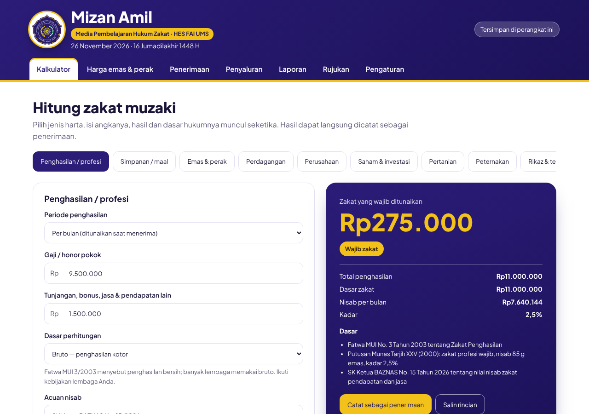
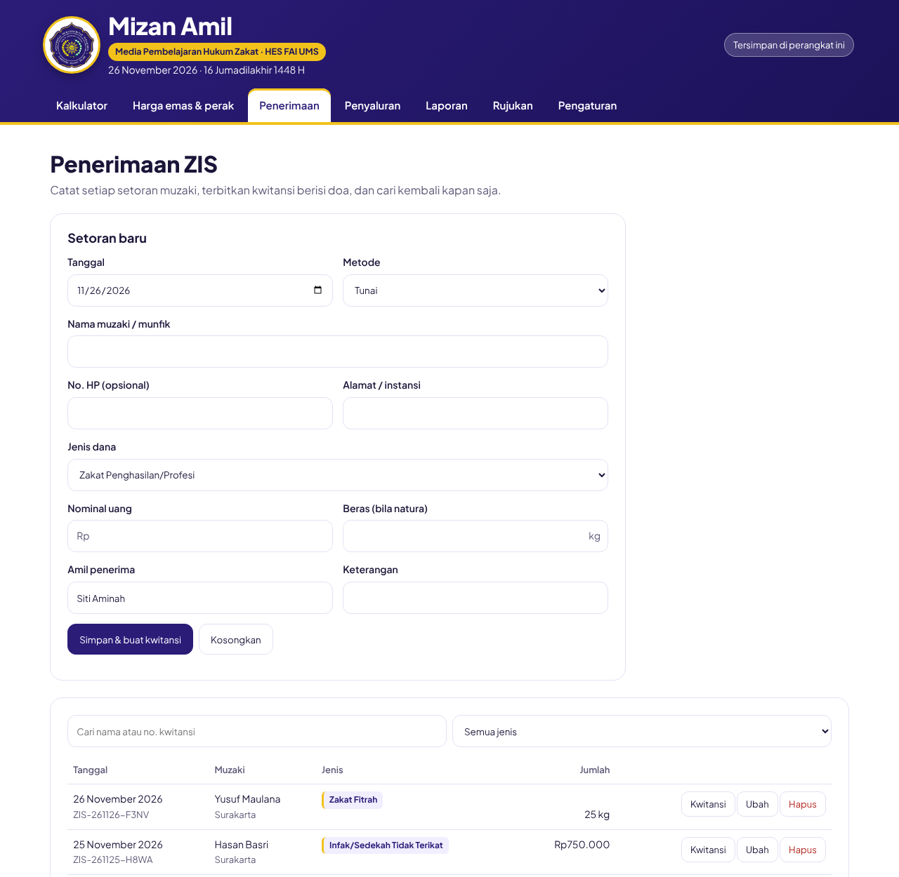
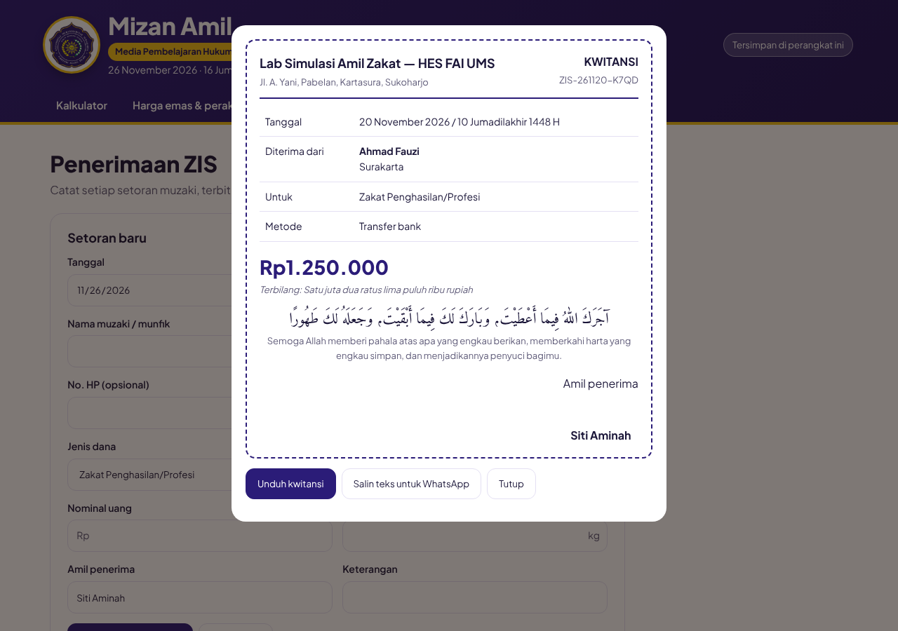
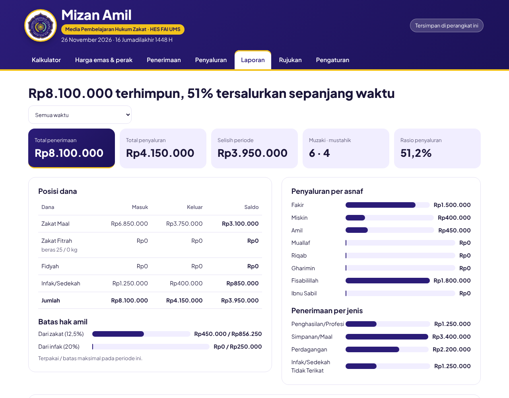

# Mizan Amil — Lab Hukum Zakat HES UMS

Kalkulator zakat dan simulasi pengelolaan zakat untuk mata kuliah **Hukum Zakat**, Program Studi Hukum Ekonomi Syariah, Fakultas Agama Islam, Universitas Muhammadiyah Surakarta.

Acuan: Fatwa MUI dan Ijtima Ulama Komisi Fatwa, putusan Munas Tarjih Muhammadiyah, serta SK BAZNAS dan regulasi Kementerian Agama (rinciannya di menu **Rujukan** dalam aplikasi).

| Kalkulator zakat | Di ponsel |
|---|---|
|  |  |

| Penerimaan dan riwayat | Kwitansi berisi doa |
|---|---|
|  |  |



*Tangkapan layar memakai data contoh.*

## Fitur

- Kalkulator 11 jenis zakat: penghasilan, simpanan, emas & perak (beberapa kadar karat), perdagangan, perusahaan, saham, pertanian, peternakan, rikaz, fitrah, fidyah
- Harga emas & perak dengan sinkronisasi harian dari Logam Mulia Antam (lihat bagian *Harga emas otomatis*) dan pengingat sebelum menyimpan
- Penerimaan dengan kwitansi PDF berdoa (di Android dibagikan lewat menu Bagikan: simpan ke Berkas, kirim ke WhatsApp, dsb.), penyaluran 8 asnaf dengan batas hak amil, laporan, ekspor CSV, cadangan JSON
- Bisa dipakai tanpa internet setelah dibuka sekali; font dibundel di dalam aplikasi sehingga tampilan dan teks Arab pada kwitansi sama saat offline

## Cara memakai

| Bentuk | Cara mendapatkan |
|---|---|
| **Web app** (semua perangkat) | Buka `https://elhakim45.github.io/mizan-amil/`, lalu pilih *Tambahkan ke layar utama* / *Instal aplikasi* di browser |
| **APK Android** | Unduh `MizanAmil-v1.0.x.apk` dari halaman [Releases](../../releases), buka di ponsel, izinkan instalasi dari sumber tidak dikenal |

Data penerimaan dan penyaluran tersimpan di perangkat masing-masing pengguna (cocok untuk latihan mahasiswa). Gunakan *Unduh cadangan (JSON)* di menu Laporan untuk memindahkan data.

## Panduan dosen

Aplikasi ini dirancang sebagai laboratorium: mahasiswa memerankan amil di kantor layanan zakat. Satu sesi praktikum dapat mengikuti alur berikut.

**Sebelum kelas**

1. Buka menu **Harga emas & perak** dan perbarui harga hari itu. Tombol *Sinkronkan harga sekarang* mengambil harga terbaru yang disiapkan otomatis tiap pagi; bila gagal, isi manual dari tautan sumber. Nisab emas, simpanan, perdagangan, perusahaan, dan saham dihitung dari harga ini, dan aplikasi memberi peringatan bila harga belum diperbarui hari itu.
2. Buka **Pengaturan**: isi nama lembaga dan alamat (tercetak di kwitansi), lalu periksa nisab penghasilan (SK BAZNAS), takaran fitrah, fidyah, serta batas hak amil.

**Kegiatan di kelas**

1. **Hitung zakat.** Di menu Kalkulator, mahasiswa memilih jenis harta, mengisi kasus, lalu membaca hasil, catatan haul, dan dasar hukum di kartu hasil. Ubah angkanya sedikit di bawah dan di atas nisab untuk melihat perbedaan hukumnya.
2. **Catat penerimaan.** Tombol *Catat sebagai penerimaan* memindahkan hasil hitungan ke formulir setoran. Mahasiswa menerbitkan kwitansi berisi doa untuk muzaki.
3. **Salurkan.** Di menu Penyaluran, dana disalurkan kepada mustahik menurut delapan asnaf. Aplikasi menolak penyaluran yang melebihi saldo sumber dana atau melebihi batas hak amil, dan fidyah hanya boleh untuk fakir atau miskin. Pesan penolakan ini bisa dipakai sebagai bahan diskusi.
4. **Laporan.** Menu Laporan menampilkan posisi dana, penggunaan hak amil, serta penerimaan dan penyaluran menurut periode.

**Pengumpulan tugas.** Karena data tersimpan di perangkat masing-masing, minta mahasiswa mengirim berkas dari menu Laporan: *cadangan (JSON)* untuk dipulihkan kembali, atau *CSV* untuk dibuka di Excel. *Pulihkan dari cadangan* menggabungkan penerimaan dan penyaluran dari berkas tersebut ke aplikasi dosen.

Ringkasan ketentuan di aplikasi adalah alat bantu hitung dan simulasi. Untuk kasus yang tidak lazim, rujuk naskah asli fatwa atau putusan, atau Majelis Tarjih dan Dewan Syariah setempat.

## Struktur

```
www/                  aplikasi web (index.html, manifest, service worker, ikon, fonts/)
assets/               logo sumber untuk ikon & splash Android
docs/gambar/          tangkapan layar untuk README
scripts/              sign-apk.sh, buat-keystore.sh / .ps1 (membuat kunci), ambil-harga.mjs (harga Antam)
capacitor.config.json konfigurasi aplikasi Android (Capacitor)
.github/workflows/    pages.yml (web) dan android.yml (APK)
```

Setiap *push* ke `main` otomatis menerbitkan ulang web app dan membuat rilis APK baru.

## Harga emas otomatis

Situs Antam menampilkan harga lewat JavaScript, sehingga tidak bisa dibaca langsung oleh aplikasi. Karena itu workflow `pages.yml` membuka situs itu dengan peramban tanpa tampilan setiap pagi (sekitar 09.40 dan 12.00 WIB, juga setiap push), menyimpan hasilnya sebagai `harga.json`, lalu menerbitkannya bersama web app. Aplikasi mengambil berkas itu saat tombol sinkronisasi ditekan. Bila pengambilan gagal, harga terakhir yang pernah terbit tetap dipakai. Cara ini bergantung pada tata letak situs Antam; bila situs berubah, lihat log langkah *Ambil harga terbaru* di tab Actions.

## Menerbitkan web app (sekali saja)

Di GitHub buka **Settings → Pages → Build and deployment → Source: GitHub Actions**. Setelah itu push berikutnya (atau *Run workflow* pada "Terbitkan web app") akan menayangkan situs.

## APK rilis bertanda tangan

Tanpa pengaturan tambahan, workflow menghasilkan APK **debug**. Untuk APK **rilis** yang bertanda tangan:

1. Buat kunci (panduan lengkap beserta alternatif tanpa JDK: [docs/panduan-kunci-apk.md](docs/panduan-kunci-apk.md)). Singkatnya, di komputer ber-JDK jalankan `bash scripts/buat-keystore.sh` (Windows: `powershell -ExecutionPolicy Bypass -File scripts\buat-keystore.ps1`). Skrip membuat `mizan-amil.jks` dan `mizan-amil.jks.base64`.
2. Di GitHub buka **Settings → Secrets and variables → Actions** dan tambahkan:

   | Secret | Isi |
   |---|---|
   | `KEYSTORE_BASE64` | isi berkas `mizan-amil.jks.base64` |
   | `KEYSTORE_PASSWORD` | kata sandi keystore |
   | `KEY_ALIAS` | `mizanamil` (atau alias yang Anda pilih) |
   | `KEY_PASSWORD` | kata sandi kunci; kosongkan bila sama dengan keystore |

3. Push ke `main`. Workflow akan membangun APK rilis, menandatanganinya, dan menerbitkannya di Releases.

Simpan `mizan-amil.jks` di tempat aman dan **jangan di-commit** (sudah diabaikan oleh `.gitignore`). Bila kunci hilang, APK baru tidak bisa lagi memperbarui APK lama. Nomor versi (`versionCode`) naik otomatis pada setiap build.

Catatan peralihan: APK debug dan APK rilis memakai tanda tangan berbeda, sehingga Android tidak mau menimpa yang satu dengan yang lain. Pengguna yang beralih ke APK rilis perlu menghapus aplikasi lama terlebih dahulu. Minta mereka mengunduh *cadangan (JSON)* dari menu Laporan sebelum menghapus.

## Build lokal (opsional)

Butuh Node.js 20+, JDK 21, dan Android SDK.

```bash
npm install
npx cap add android
npm run icons
npx cap sync android
npm run apk   # hasil: android/app/build/outputs/apk/debug/app-debug.apk
```

## Lisensi pihak ketiga

Font **Plus Jakarta Sans** dan **Amiri** dibundel di `www/fonts/` dengan lisensi SIL Open Font License 1.1 (teks lisensi ada di folder yang sama).
